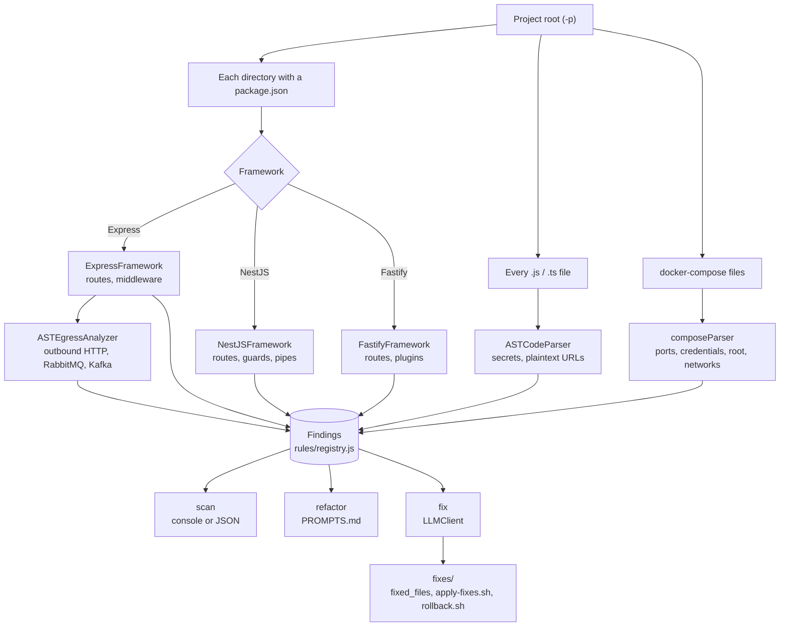

# MicroSec-Scan

A static security scanner for Node.js microservices. It parses every service into an AST and checks how the services talk to each other: calls between services with no auth header, RabbitMQ or Kafka over plaintext, the same broker credentials reused across services in `docker-compose.yml`, outbound calls with no circuit breaker. It also runs the usual per-service checks (helmet, rate limiting, CORS, unprotected routes, hardcoded secrets) for Express, NestJS and Fastify.

Dependency and container scanners like Trivy and Snyk don't look at this layer, and Semgrep matches patterns one file at a time, so none of them will tell you that `orders` calls `payments` over plain HTTP without authenticating. That's the gap this tool is for.

There's also an optional `fix` command that sends findings to an LLM and writes patches for you to review.

## What's in this repo

This repo holds two tools. MicroSec-Scan covers the application code of your microservices, and [SafeFix-K8s](#safefix-k8s) covers the Kubernetes manifests they deploy with.

| | MicroSec-Scan | SafeFix-K8s |
| --- | --- | --- |
| Looks at | Node.js microservice code and `docker-compose.yml` | Kubernetes manifests |
| Built with | Node.js 18+ | Python 3.8+ and Docker |
| Where | Repo root (`bin/`, `src/`) | [`SafeFix-K8s/`](./SafeFix-K8s) |
| Docs | This README | [`SafeFix-K8s/README.md`](./SafeFix-K8s/README.md) |

The two don't depend on each other. Install and run whichever you need.

## Install

It isn't on npm yet, so install from source (Node 18+):

```bash
git clone https://github.com/yousefnegmeldin/microservices-security-scanner.git
cd microservices-security-scanner
npm install
npm link    # puts microsec-scan on your PATH
```

## Scan

Point `-p` at the root of the repo that holds your services. Every directory with a `package.json` is treated as a service, and any `docker-compose` file in the tree is parsed too.

```bash
microsec-scan scan -p ./shop
microsec-scan scan -p ./shop --show-routes --show-egress   # route table + outbound connections
microsec-scan scan -p ./shop -f json -o report.json
```

Here's part of the output for a small two-service app where `orders` publishes to RabbitMQ and calls `payments` over HTTP:

```
📄 ./shop/orders/index.js
  ├─ [INSECURE_HTTP] HTTP connection instead of HTTPS (line 11) (MEDIUM)
  ├─ [MISSING_CIRCUIT_BREAKER] Service-to-service call to http://payments:4000/charge without circuit breaker pattern (line 11) (MEDIUM)
  ├─ [MISSING_MESSAGE_VALIDATION] RabbitMQ sendToQueue() without schema validation (consider JSON Schema, Avro, or Protobuf) (line 10) (MEDIUM)
  ├─ [MISSING_SERVICE_AUTH] Service-to-service call to http://payments:4000/charge without authentication header (line 11) (CRITICAL)
  ├─ [PLAINTEXT_BROKER] RabbitMQ uses non-TLS amqp:// connection (line 8) (HIGH)
  ├─ [UNPROTECTED_ROUTE] Sensitive route POST /orders lacks authentication (line 7) (HIGH)

📄 ./shop/docker-compose.yml
  ├─ [EXPOSED_INTERNAL_PORT] payments exposes port 4000:4000 to all network interfaces (0.0.0.0). Consider binding to 127.0.0.1 for internal services. (line 10) (CRITICAL)
  ├─ [SHARED_BROKER_CREDENTIALS] orders shares RabbitMQ credentials 'guest' with 1 other service(s): payments (line 2) (HIGH)
```

## What it checks

**Between services**

| Rule | Fires when |
| --- | --- |
| `MISSING_SERVICE_AUTH` | An outbound call to an internal service has no `Authorization` header |
| `MISSING_MUTUAL_TLS`, `MISSING_REQUEST_SIGNING` | Service-to-service calls without mTLS or an HMAC/signature |
| `EXCESSIVE_SERVICE_TRUST` | A service in compose is attached to more than two networks |
| `MISSING_CIRCUIT_BREAKER` | An outbound call isn't wrapped by opossum, hystrixjs, brakes, etc. |
| `PLAINTEXT_BROKER`, `EGRESS_INSECURE_RABBITMQ` | `amqp.connect()` with `amqp://` instead of `amqps://` |
| `KAFKA_PLAINTEXT`, `KAFKA_MISSING_SASL` | A `new Kafka({...})` config with no `ssl` or no `sasl` |
| `MISSING_MESSAGE_VALIDATION`, `KAFKA_MISSING_SCHEMA_VALIDATION` | Publishing without an ajv/joi/schema check in the same function |
| `MISSING_MESSAGE_ENCRYPTION`, `MISSING_QUEUE_AUTHORIZATION` | Broker messages sent unencrypted, or queues with no ACL setup in code |
| `SHARED_BROKER_CREDENTIALS` | Two or more services in compose use the same RabbitMQ user/password |
| `EXPOSED_INTERNAL_PORT` | An internal service's port is published on all interfaces |
| `EGRESS_INSECURE_HTTP`, `EGRESS_INSECURE_KAFKA`, `EGRESS_UNENCRYPTED_EXTERNAL_API` | Outbound traffic over unencrypted transports |
| `SERVICE_REGISTRY_POISONING`, `UNENCRYPTED_SERVICE_MESH` | Compose runs Consul/Eureka with no ACL or auth settings, or Istio/Linkerd with no mTLS settings |

**Inside a service**

- Express: `MISSING_HELMET`, `MISSING_RATE_LIMITING`, `PERMISSIVE_CORS`, `MISSING_BODY_SIZE_LIMIT`, `MISSING_AUTHENTICATION`, `UNPROTECTED_ROUTE`, `EXPOSED_INTERNAL_ENDPOINT`
- NestJS: `NESTJS_MISSING_HELMET`, `NESTJS_MISSING_RATE_LIMIT`, `NESTJS_PERMISSIVE_CORS`, `NESTJS_MISSING_GUARDS`, `NESTJS_MISSING_VALIDATION_PIPE`
- Fastify: `FASTIFY_MISSING_HELMET`, `FASTIFY_MISSING_RATE_LIMIT`, `FASTIFY_PERMISSIVE_CORS`, `FASTIFY_MISSING_AUTH`
- Any service: `HARDCODED_SECRET`, `INSECURE_HTTP`

**docker-compose:** `ROOT_CONTAINER`, `DEFAULT_CREDENTIALS`, plus the compose-based rules above.

Severities live in [`src/rules/registry.js`](./src/rules/registry.js).

## Fixing findings

There are two ways to do it.

**`refactor`** doesn't call a model. It scans the project and writes `PROMPTS.md` and `findings.json` to `./refactor_output`, and you paste the prompts into whatever LLM you use.

```bash
microsec-scan refactor -p ./shop
```

**`fix`** calls the model for you:

```bash
export GROQ_API_KEY=...
microsec-scan fix -p ./shop --provider groq
```

- Providers: `groq` (default model `llama-3.3-70b-versatile`), `openrouter`, `together`, `openai`. Override the model with `--model`.
- The key is read from `--api-key`, then the provider's env var (`GROQ_API_KEY`, `OPENROUTER_API_KEY`, `TOGETHER_API_KEY`, `OPENAI_API_KEY`), then `LLM_API_KEY`. `.env` files aren't loaded, so export it. If you leave out the provider or key, it asks.
- It lets you pick which files to fix. Pass `--all` to skip that.

Your source files aren't touched. Everything goes to `<project>/fixes/`:

```
fixes/
├── fixed_files/            fixed copies of each file
├── apply-fixes.sh          copies them over your sources
├── rollback.sh             restores the originals
├── FIXES_SUMMARY.md
├── REMEDIATION_REPORT.md   before/after for each finding
└── baseline.json           findings before the fix
```

The prompt tells the model to make the smallest change that fixes the finding and not to rename variables, env vars or functions (for example, `amqp://` becomes `amqps://` and nothing else changes). Models still get it wrong sometimes, so read the diff before you run `apply-fixes.sh`. Nothing is committed for you.

To check whether the fixes worked, scan before and after and compare:

```bash
microsec-scan scan -p ./shop -f json -o before.json
# apply fixes
microsec-scan scan -p ./shop -f json -o after.json
microsec-scan compare -b before.json -c after.json   # writes ./metrics/comparison.json
```

## How it works



JS and TS files are parsed with `@babel/parser`, and most checks look at specific AST nodes, like the first argument to `amqp.connect()` or the config object passed to `new Kafka()`. Compose files are read with `js-yaml`. Each check calls `createFinding()` with a rule ID from the registry, which fills in the severity and message.

## Limitations

- The service-to-service rules (`MISSING_SERVICE_AUTH`, `MISSING_CIRCUIT_BREAKER`, the message broker rules and so on) come from `ASTEgressAnalyzer`, which currently only runs on Express services. NestJS and Fastify services still get their framework checks plus `INSECURE_HTTP` and `PLAINTEXT_BROKER`.
- Only Node.js and TypeScript. In a polyglot repo it scans the Node services and skips the rest, though it still checks their outbound calls to services written in other languages.
- It's static analysis, so connections that are only resolved at runtime (a URL built from env vars, service discovery, a wrapper the scanner doesn't recognise) can be missed. That was the main cause of missed findings in our evaluation.
- Some rules can only see the code. If you set queue ACLs on the RabbitMQ server itself, for example, the scanner can't see that.

## SafeFix-K8s

[`SafeFix-K8s/`](./SafeFix-K8s) is a separate tool with its own language, dependencies and install steps. It takes a directory of Kubernetes manifests and runs four stages:

1. **Detection** runs 10 to 13 scanners (Checkov, Trivy, Kubescape, Polaris, KubeLinter and others) through Docker, depending on the `lean` or `extended` mode.
2. **Normalization** merges their output into 50+ standard categories and filters out false positives.
3. **Repair** applies deterministic fixes and templates first, then falls back to LLM-generated patches (OpenAI, Groq, Gemini or OpenRouter) for what's left.
4. **Validation** checks every fixed manifest against a 7-gate validation framework.

You need Python 3.8+ and Docker. From the repo root:

```bash
cd SafeFix-K8s
pip install -r requirements.txt
cp .env.example .env     # then add a key for each LLM provider you plan to use
python pipeline.py --input ./k8s-manifests --output ./results
```

Fixed manifests are written to `results/repair/` as `SECURED_*.yaml`, each with a matching `EXPLANATION_*.yaml.md` that says what changed and why.

More detail is in [`SafeFix-K8s/README.md`](./SafeFix-K8s/README.md), the [usage guide](./SafeFix-K8s/USAGE_GUIDE.md) and the [methodology](./SafeFix-K8s/METHODOLOGY.md).

## Research

MicroSec-Scan and SafeFix-K8s are the two tools in our paper *MicroSec-Scan and SafeFix-K8s for Automated Analysis and Repair in Microservices and Kubernetes* (Negmeldin, Hegab, Singergy, Zamzam, Zaki). MicroSec-Scan covers the application side, and SafeFix-K8s, in [`SafeFix-K8s/`](./SafeFix-K8s), covers the Kubernetes side. The results below are for MicroSec-Scan.

We evaluated it on five Node.js microservice apps, four open-source and one of our own. It found inter-service issues in all five, where Trivy and Snyk reported none. Measured per vulnerability category against labels we wrote by hand, precision was 1.00 and recall ranged from 0.33 to 0.93 (average F1 0.77). Each scan took under half a second on a MacBook Air M4.

## License

MIT
